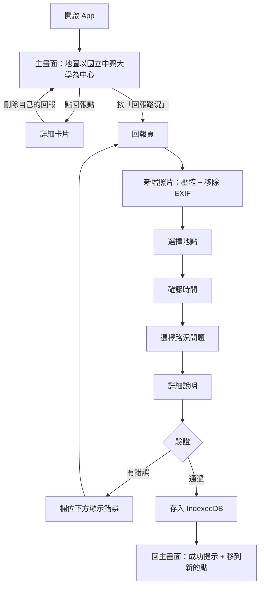
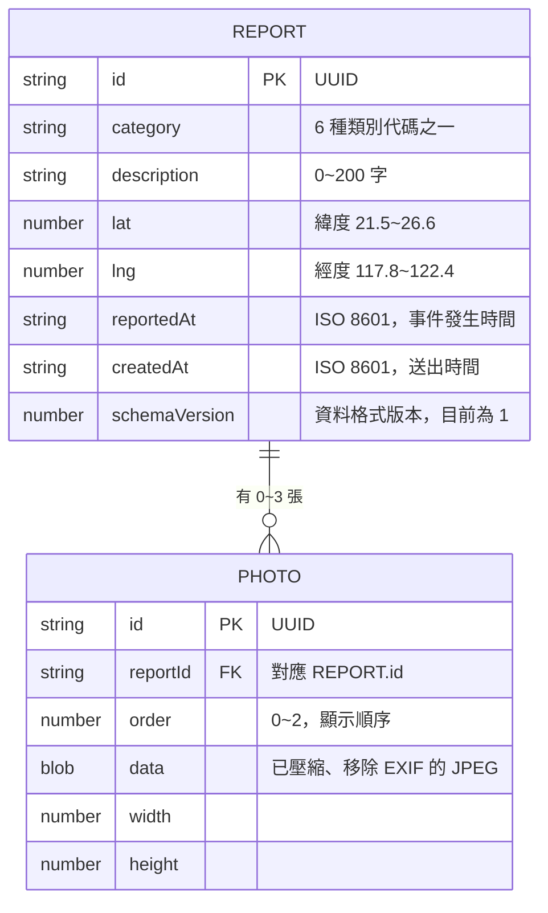

# 行人地獄 App — 規格文件（MVP 示意版）

> 版本：v0.1（階段 0 規劃）｜最後更新：2026-11-25

## 1. 產品概述

- **一句話**：幫助台灣行人安心走在馬路上。
- **問題**：人行道不連續，或被電箱、路樹、施工佔用，行人只能走到車道上。現在的投訴管道效率低，也查不到進度。
- **MVP 目標**：用最簡單的技術做出「看地圖 → 回報路況 → 地圖馬上出現新回報」的完整體驗，用來展示和測試。
- **目標使用者**：15–60 歲的台灣行人，主要用手機。
- **語言**：繁體中文。
- **範圍**：全台灣（含澎湖、金門、馬祖）。

### MVP 不做的事

- 不做登入或帳號
- 不做雲端資料庫，也不做多人共享（資料只存在使用者自己的瀏覽器）
- 不做政府單位串接和進度追蹤
- 不做地址搜尋、路線規劃
- 不做深色模式

## 2. 架構決策（方案 A：純前端示意）

| 決策           | 內容                                                         | 原因                             |
| -------------- | ------------------------------------------------------------ | -------------------------------- |
| 資料儲存       | 瀏覽器 IndexedDB（裝置本機）                                 | 不需要伺服器；可以存照片；免費   |
| 「即時」的意思 | 使用者送出後，**自己的地圖**立刻出現新的點，重新整理後也還在 | 示意用。其他使用者看不到這筆資料 |
| 範例資料       | 不提供範例資料（地圖一開始是空的）                           | 依需求變更                       |
| 地圖           | Leaflet + CARTO Voyager 圖磚（OpenStreetMap 資料）           | 免費，不用帳號和金鑰；文字較少   |

日後要升級成多人共享版（方案 B，例如 Supabase）時，資料欄位已經設計成可以直接對應到資料表（見第 6 節），也必須補上第 8.3 節列的伺服器端安全措施。

## 3. 頁面清單

| 路由       | 頁面                 | 說明                                                                 |
| ---------- | -------------------- | -------------------------------------------------------------------- |
| `#/`       | 主畫面：即時路況地圖 | 全螢幕地圖、回報點、圖例、「回到中興大學」按鈕、「回報路況」浮動按鈕 |
| `#/report` | 回報路況             | 表單頁                                                               |

> 使用 hash 路由（網址中有 `#`），因為 GitHub Pages 不支援單頁應用的其他路由方式，重新整理時會出現 404。

## 4. 功能規格

### 4.1 主畫面：即時路況地圖

**地圖**

- **不使用 GPS 定位，也不詢問定位權限。** 每次開啟地圖都以台中市南區「國立中興大學」為中心（24.1226°N, 120.6750°E，縮放等級 16）
- 地圖可以拖曳的範圍限制在台灣附近（緯度 21.5–26.6、經度 117.8–122.4），避免滑到空白海面
- 地圖只呈現台灣地區：中國大陸陸地以灰色遮罩覆蓋（資料來源：Natural Earth 1:10m 國界，公有領域；由 `scripts/gen-mask.mjs` 產生 `src/data/chinaMask.json`）。精度約數百公尺，放大到街道層級時海岸線可能略有誤差
- 右下角有「回到國立中興大學」按鈕（房子圖示）
- 底圖使用 CARTO Voyager 樣式：風格接近 Google Maps，巷弄、店家文字較少，不顯示門牌
- 地圖右下角標示「© OpenStreetMap contributors © CARTO」（使用條款規定必須標示）

**回報點**

- 每一類路況問題用不同顏色和圖示的標記：

| 類別代碼        | 顯示名稱     | 顏色（暫定） |
| --------------- | ------------ | ------------ |
| `discontinuous` | 不連續人行道 | 紅 #D32F2F   |
| `obstacle`      | 障礙物阻擋   | 橘 #F57C00   |
| `damaged`       | 人行道破損   | 棕 #795548   |
| `occupied`      | 違規佔用     | 紫 #7B1FA2   |
| `construction`  | 施工         | 黃 #F9A825   |
| `other`         | 其他         | 灰 #616161   |

- 左下角有可以收合的圖例
- 點一下回報點 → 從下方滑出詳細卡片，內容是照片（可左右滑動）、類別、時間、說明，以及「刪除」按鈕（只有使用者自己的回報才有）。關閉方式：往下滑（超過 100px 或快速下滑）、按 ✕、點地圖空白處、按 Esc
- 刪除前會跳出確認視窗

**四種狀態**

| 狀態     | 顯示                                                                                             |
| -------- | ------------------------------------------------------------------------------------------------ |
| 載入中   | 地圖區域顯示載入動畫，並顯示「正在取得位置…」                                                    |
| 沒有資料 | 這台裝置還沒有回報時，顯示「目前沒有回報，成為第一個回報的人吧！」                               |
| 錯誤     | 地圖圖磚載入失敗時顯示「地圖載入失敗，請檢查網路」和「重試」按鈕；讀取本機資料失敗時顯示錯誤訊息 |
| 成功     | 從回報頁回來時，顯示「回報成功！」提示，地圖移到新的回報點                                       |

### 4.2 回報路況

**流程**：首頁 → 回報路況 → 新增照片 → 選擇地點 → 時間 → 路況問題 → 詳細說明 → 提交

| 欄位     | 必填                   | 規則                                                                                                                                                                                             |
| -------- | ---------------------- | ------------------------------------------------------------------------------------------------------------------------------------------------------------------------------------------------ |
| 照片     | 選填                   | 最多 3 張；每張原始檔 ≤ 10MB；只接受 JPG / PNG / HEIC（iPhone 預設格式）。選好後會自動：① 縮小到長邊 1280px ② 轉成 JPEG（品質 0.8）③ **移除 EXIF 等所有附加資訊，包含 GPS 位置**。可以預覽和移除 |
| 地點     | 必填                   | 頁面上有一個小地圖，中央固定一根大頭針，預設在國立中興大學（不使用 GPS），使用者拖曳地圖把大頭針對準問題地點。地點必須在台灣範圍內                                                               |
| 時間     | 必填                   | 自動帶入現在時間，可以改；不能選未來時間，也不能早於 30 天前                                                                                                                                     |
| 路況問題 | 必填                   | 6 選 1，用大按鈕呈現（不用下拉選單，手機比較好點）                                                                                                                                               |
| 詳細說明 | 選填；選「其他」時必填 | 最多 200 字，顯示字數計算；儲存前去除前後空白                                                                                                                                                    |

**表單錯誤提示**

- 錯誤訊息顯示在該欄位的正下方，用紅字，並說明怎麼修正。例如「請選擇路況問題」、「照片不能超過 10MB」、「只接受 JPG、PNG、HEIC 格式」
- 按下提交時如果有錯誤，畫面捲到第一個錯誤的欄位
- 提交中，按鈕顯示「送出中…」並鎖住，避免重複送出

**四種狀態**

| 狀態     | 顯示                                                                                                 |
| -------- | ---------------------------------------------------------------------------------------------------- |
| 載入中   | 處理照片時顯示「照片處理中…」；送出時按鈕顯示「送出中…」                                             |
| 沒有資料 | 還沒選照片時，顯示「＋ 新增照片」的空白方框                                                          |
| 錯誤     | 欄位錯誤顯示在欄位下方；儲存失敗（例如手機空間不足）時顯示「儲存失敗，請稍後再試」，並保留已填的內容 |
| 成功     | 回到主畫面，顯示「回報成功！」，地圖移到新的點                                                       |

**離開頁面**：已經填了內容卻按「返回」時，先確認「確定要放棄這次回報？」

## 5. 使用者流程

## 6. 資料設計

資料存在瀏覽器 IndexedDB，資料庫名稱 `passenger-db`，有兩個資料表（object store）。

- 不提供範例資料；地圖上只有使用者自己在這台裝置上建立的回報
- 時間一律存成 ISO 8601 字串，顯示時轉成台灣時間，格式例如 `2026/11/25 14:30`
- 匯出格式：全部是 JSON 加 JPEG，日後可以直接匯入雲端資料庫

## 7. 權限規則

- 不需要登入，所有人使用相同的功能
- 使用者只能刪除**自己這台裝置**上的回報
- 瀏覽器權限：
  - **定位**：不使用，App 不會詢問定位權限
  - **相機和相簿**：透過 `<input type="file" accept="image/*">` 由系統詢問，App 不直接控制相機

## 8. 「API」清單

MVP 沒有伺服器 API。下面列出程式內部的資料存取函式，以及會用到的外部和瀏覽器服務。

### 8.1 內部資料存取函式（`src/lib/storage.ts`）

| 函式                                           | 說明                         |
| ---------------------------------------------- | ---------------------------- |
| `listReports(): Promise<Report[]>`             | 讀取全部回報（不含照片內容） |
| `getReportPhotos(reportId): Promise<Photo[]>`  | 讀取某一筆回報的照片         |
| `createReport(input, photos): Promise<Report>` | 驗證後儲存，回傳新的回報     |
| `deleteReport(reportId): Promise<void>`        | 刪除回報和它的照片           |

這 4 個函式日後改成方案 B 時，就是要換成雲端 API 的地方。

### 8.2 外部與瀏覽器服務

| 服務                                                 | 用途     | 是否需要金鑰 | 費用                                                                                                        |
| ---------------------------------------------------- | -------- | ------------ | ----------------------------------------------------------------------------------------------------------- |
| CARTO Voyager 圖磚 `{a,b,c,d}.basemaps.cartocdn.com` | 地圖底圖 | 否           | 免費，限非商業使用（每月約 7.5 萬次地圖瀏覽內），需標示 OpenStreetMap 與 CARTO；商業使用需向 CARTO 購買授權 |
| 瀏覽器 IndexedDB                                     | 儲存資料 | 否           | 免費                                                                                                        |

### 8.3 升級成方案 B 時必須補上的事（MVP 不做）

- 所有輸入都要在伺服器端再驗證一次
- 上傳和建立回報要有速率限制
- 照片放在私有儲存空間，限制格式和大小
- 照片內容審核（避免不當照片）
- 使用者識別要由伺服器端產生

## 9. 安全與隱私

| 項目                | 做法                                                                                                                                                                |
| ------------------- | ------------------------------------------------------------------------------------------------------------------------------------------------------------------- |
| 照片 EXIF / GPS     | 用 canvas 重新繪製並輸出 JPEG，再刪除輸出檔中所有 APP1、APP3–15 與註解區段（iPhone Safari 輸出時會自己加入 EXIF），最後確認不含 EXIF 才使用。單元測試涵蓋偵測與刪除 |
| 位置資料            | 不取得使用者 GPS 位置；回報地點由使用者在地圖上選擇，只存在使用者自己的裝置（瀏覽地圖時，CARTO 會收到所看區域的圖磚請求與 IP 位址）                                 |
| 個人資料            | 不收集姓名、電話、email                                                                                                                                             |
| 使用者輸入          | 說明文字一律當作純文字顯示（React 預設會跳脫特殊字元），**禁止使用 `dangerouslySetInnerHTML`**                                                                      |
| 金鑰                | MVP 沒有任何金鑰；仍然建立 `.gitignore` 排除 `.env*`，並提供 `.env.example`                                                                                         |
| 第三方程式          | 只用 npm 套件打包，不從外部網址載入程式                                                                                                                             |
| 內容安全政策（CSP） | 用 `<meta>` 標籤限制只能從自己的網站和 CARTO 圖磚主機載入資源（`tests/mapConfig.test.ts` 檢查兩邊一致）                                                             |

## 10. UI / UX

- 手機優先，參考 Google Maps 的乾淨簡約風格
- **主色**：安全橘 `#F57C00`；背景白色和淺灰 `#F5F5F5`；文字深灰 `#212121`
- 字型：系統預設字型（iPhone 是蘋方、Android 是 Noto Sans TC），不另外下載字型
- 可以點的元素至少 44×44px（Apple 建議尺寸）
- 浮動按鈕「＋ 回報路況」固定在畫面下方中央，並避開 iPhone 底部的橫條區域（safe area）
- 不做深色模式

## 11. PWA

- 可以從 Safari「分享 → 加入主畫面」安裝
- App 名稱：`行人地獄`，短名稱：`行人地獄`
- 圖示：用簡單圖形製作（橘色底加白色行人），提供 192、512 和 Apple touch icon（180）
- 顯示模式 `standalone`（打開時沒有瀏覽器網址列）
- 離線時：App 的介面可以開啟；地圖圖磚需要網路，沒有網路時顯示錯誤狀態

## 12. 技術選擇與費用

| 項目          | 選擇                                                   | 費用             |
| ------------- | ------------------------------------------------------ | ---------------- |
| 渲染方式      | 純前端 SPA（hash 路由）                                | 0                |
| 框架 / 語言   | React 18 + Vite + TypeScript                           | 0                |
| 樣式          | Tailwind CSS                                           | 0                |
| 地圖          | Leaflet + react-leaflet + CARTO Voyager 圖磚           | 0（限非商業）    |
| 後端 / 資料庫 | 不使用；瀏覽器 IndexedDB（用 `idb` 套件）              | 0                |
| 登入          | 不使用                                                 | 0                |
| PWA           | vite-plugin-pwa                                        | 0                |
| 部署          | GitHub Pages + GitHub Actions                          | 0（public repo） |
| 程式碼檢查    | ESLint + Prettier + `tsc` 型別檢查                     | 0                |
| 測試          | Vitest（單元測試）+ Playwright（端對端測試，最後階段） | 0                |
| 監控          | MVP 不設定（正式上線時建議用 Sentry，有免費方案）      | 0                |

**總費用：0 元；不需要申請任何帳號或金鑰。**

**正式網址**：`https://bluedog0050.github.io/passenger/`

## 13. 開發階段

| 階段 | 內容                                                                                                                                                | 完成標準                                |
| ---- | --------------------------------------------------------------------------------------------------------------------------------------------------- | --------------------------------------- |
| 0    | 規劃：本文件和 `CLAUDE.md`                                                                                                                          | 你確認                                  |
| 1    | 專案基礎：Vite + React + TS + Tailwind、ESLint/Prettier/Vitest、基本版面（全螢幕地圖 + 浮動按鈕 + 空白回報頁）、PWA 設定和圖示、GitHub Actions 部署 | 正式網址可以開啟，iPhone 可以加到主畫面 |
| 2    | （跳過，不需要資料庫和登入）                                                                                                                        | —                                       |
| 3-1  | 即時地圖：定位和預設位置、範例資料、分類標記、圖例、詳細卡片、四種狀態                                                                              | 你在手機上確認                          |
| 3-2  | 回報路況：表單、照片壓縮和移除 EXIF、選擇地點、驗證、IndexedDB 儲存和刪除、回主畫面顯示新回報                                                       | 你在手機上確認                          |
| 最後 | 品質檢查（精簡版）：逐項檢查安全和隱私、Playwright 測試關鍵流程、手機畫面和效能檢查、上線前待辦清單                                                 | 報告                                    |

## 14. 待決事項與已做的預設決定

- 「回報成功」的訊息只寫「回報成功！已顯示在地圖上」，**不會寫「已送至政府單位」**，避免使用者誤以為已經正式陳情（依照需求，不額外加測試版標示）
